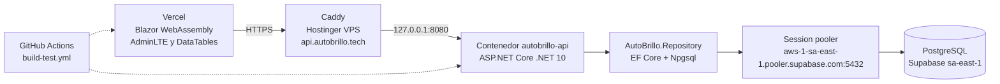

# AutoBrillo

Sistema académico de la UPE (Paraguay) para la gestión de un lavadero de autos. La solución usa una arquitectura por capas, nombres en español y el código que está publicado hoy en producción.

## Enlaces publicados


- **Aplicación web:** https://autobrillo-lemon.vercel.app
- **API:** https://api.autobrillo.tech/health
- **Base de datos:** PostgreSQL en Supabase, región `sa-east-1`, accedida por el session pooler

## Equipo

| Integrante | Responsabilidad |
|---|---|
| René Alvarez | Backend y datos |
| Arturo Valdez | Frontend |
| Izan Alvarez | Pruebas |
| Liz Benitez | Análisis y documentación |
| Bruno Torres | Scrum Master |

## Qué hace el sistema

- Inicio de sesión con nombre y contraseña. La contraseña se guarda como hash BCrypt.
- JWT con roles. El login devuelve `token`, `usuario`, `roles` y `esAdministrador`.
- Un usuario inactivo no puede entrar ni seguir usando un token ya emitido.
- `POST /api/auth/register` exige el rol `Administrador`.
- ABM de usuarios, roles, personas (cliente, funcionario, proveedor) y productos.
- Vehículos, tipos de vehículo, servicios, precios por tipo (con historial y fila `Vigente`) y adicionales.
- Inventario, compras a proveedores, lavados, ventas, cobros y comisiones.
- Interfaz Blazor WebAssembly con AdminLTE 4.10.2 y DataTables 2.3.4, copias locales en `wwwroot/lib`. Los listados usan el componente `TablaDatos`. Los tipos de persona y de producto se marcan con casillas visibles, y las acciones de las tablas son botones compactos en una sola línea.
- Comprobación de la API con `/health` y de la base con `/health/base-datos`.

## Arquitectura publicada



La web no se conecta a Supabase. Cada solicitud autenticada recorre Web, API, Repository y el pooler hasta PostgreSQL.

## Proyectos de la solución

| Proyecto | Responsabilidad |
|---|---|
| `AutoBrillo.Model` | Entidades y reglas del lavadero: usuarios, personas, productos, vehículos, stock, compras, lavados, ventas y comisiones. |
| `AutoBrillo.Repository` | Entity Framework Core y Npgsql. Hash BCrypt. |
| `AutoBrillo.Api` | HTTP/JSON, JWT, CORS y los controladores. |
| `AutoBrillo.Web` | Blazor WebAssembly. Consume solo la API. |
| `tests/AutoBrillo.Web.Tests` | 99 pruebas xUnit. Las ejecuta GitHub Actions. |

## Ejecución local

Requisitos: .NET SDK 10 y una base PostgreSQL o un proyecto Supabase. Los secretos no van en Git. La plantilla está en [`.env.example`](.env.example).

```bash
dotnet restore
dotnet build AutoBrillo.slnx
```

En la terminal de la API:

```bash
export CONNECTION_STRING='Host=aws-1-sa-east-1.pooler.supabase.com;Port=5432;Database=postgres;Username=REEMPLAZAR;Password=REEMPLAZAR;SSL Mode=Require'
export JWT_SECRET='una-clave-larga-privada'
export JWT_ISSUER='AutoBrillo.Api'
export JWT_AUDIENCE='AutoBrillo.Web'
export WEB_ORIGIN='http://localhost:5003'
dotnet run --project src/AutoBrillo.Api
```

En otra terminal:

```bash
dotnet run --project src/AutoBrillo.Web
```

La API local escucha en `http://localhost:5099` y la web en `http://localhost:5003`. Para apuntar la web a esa API, cambiar `ApiUrl` solo en una copia local de `src/AutoBrillo.Web/wwwroot/appsettings.json`. El valor publicado es `https://api.autobrillo.tech/`.

Las pruebas:

```bash
dotnet test AutoBrillo.slnx
```

## Documentación

- [Arquitectura](docs/arquitectura.md)
- [Módulos, tablas y migraciones](docs/personas-y-productos.md)
- [Referencia de la API](docs/api.md)
- [Despliegue](docs/despliegue.md)
- [Guía para la exposición](docs/guia-para-exposicion.md)

## Configuración

`.env.production`, `appsettings.Development.json` y `.supabase-db-password` están ignorados. Cada integrante usa sus propias variables. No se commitean secretos ni cadenas de conexión completas.
