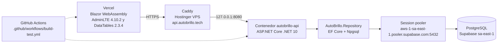
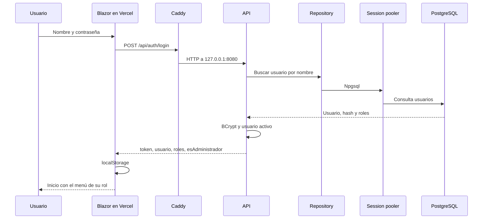

# Arquitectura de AutoBrillo

Proyecto académico de la UPE (Paraguay). Cada capa tiene una responsabilidad y la siguiente no se salta.

```text
Navegador (Blazor WebAssembly en Vercel)
  → HTTPS Caddy en el VPS Hostinger
  → AutoBrillo.Api
  → AutoBrillo.Repository (EF Core + Npgsql)
  → session pooler de Supabase
  → PostgreSQL
```

## Despliegue



GitHub Actions no participa en la solicitud del usuario. La línea punteada marca el código que ese workflow compila y prueba, en cada pull request y en cada push a `main`. Vercel publica la web por su integración con el repositorio. El VPS se actualiza a mano, como se describe en [despliegue](despliegue.md).

La web publicada está en https://autobrillo-lemon.vercel.app. Su `ApiUrl` es `https://api.autobrillo.tech/`. Caddy termina TLS. El contenedor solo escucha en el loopback del VPS.

## Capas

### AutoBrillo.Model

Entidades y reglas, sin conocer HTTP ni el proveedor de base de datos.

Entidades: `Usuario`, `Rol`, `Persona`, `TipoPersona`, `Producto`, `TipoProducto`, `TipoVehiculo`, `Vehiculo`, `PrecioServicio`, `ServicioInsumo`, `MovimientoStock`, `Compra`, `CompraDetalle`, `Lavado`, `LavadoServicio`, `LavadoParticipante`, `LavadoHistorialEstado`, `Venta`, `VentaDetalle`, `Cobro`, `ConfiguracionComision` y `Comision`.

Las reglas de negocio viven en `Reglas/`. Una `ReglaNegocioException` llega al cliente como HTTP 400 con `{ "mensaje": "..." }`.

### AutoBrillo.Repository

Entity Framework Core con el proveedor Npgsql. `AutoBrilloDbContext` mapea las tablas de `public`. Los repositorios cubren usuarios, roles, personas, productos, catálogos, vehículos, servicios, inventario, compras y las operaciones del sprint 3. `PasswordHasher` genera y verifica hashes BCrypt.

La cadena de conexión entra por la variable `CONNECTION_STRING`. En producción apunta al session pooler `aws-1-sa-east-1.pooler.supabase.com`, puerto 5432. El host directo de Supabase es solo IPv6 y el VPS no lo alcanza.

### AutoBrillo.Api

ASP.NET Core sobre .NET 10. Expone JSON, firma y valida JWT, aplica CORS con `WEB_ORIGIN` y registra los repositorios en `Program.cs`.

Roles usados por la API:

| Rol | Alcance |
|---|---|
| `Administrador` | Todo el sistema, altas de usuarios, anulaciones, precios y comisiones. |
| `Supervisor` y `Caja` | Lavados, ventas y cobros. Leen vehículos, personas y productos. No anulan. |
| `Stock` | Compras, movimientos de stock y lectura de personas y productos. |

El token dura 8 horas e incluye el identificador, el nombre y los roles. En cada solicitud autenticada la API vuelve a leer el usuario: si está inactivo, el token deja de servir.

### AutoBrillo.Web

Blazor WebAssembly. Corre en el navegador y llama a la API con `HttpClient`. No tiene cadena de conexión.

La interfaz usa copias locales, declaradas en `wwwroot/index.html`:

- AdminLTE 4.10.2, con Bootstrap 5.3.8 y Bootstrap Icons 1.13.1, en `wwwroot/lib`.
- DataTables 2.3.4 y jQuery, también locales.
- El componente `Shared/TablaDatos.razor` inicializa DataTables sobre los listados (`wwwroot/js/tablas.js`) sin romper los `@onclick` de Blazor.

Pantallas: `Login`, `Inicio`, `Usuarios`, `Roles`, `Personas`, `Vehiculos`, `Productos`, `Servicios`, `Inventario`, `Compras`, `Lavados`, `Ventas` y `Comisiones`. El menú de `MainLayout` cambia según el rol.

### Pruebas

`tests/AutoBrillo.Web.Tests` es un proyecto xUnit con 94 pruebas. Cubre reglas, seguridad de roles, RLS declarado en las migraciones y comportamiento de pantallas y repositorios. El workflow `.github/workflows/build-test.yml` ejecuta `dotnet build` y `dotnet test`.

## Recorrido de una solicitud



El mismo camino se usa después del login. La web agrega `Authorization: Bearer` y la API autoriza por rol antes de llamar al repositorio.

## Decisiones

- Nombres y comentarios en español, para la defensa en la UPE.
- Una API y una base. Sin microservicios, CQRS ni MediatR.
- La web no habla con Supabase. RLS está habilitado en las tablas de `public` y no hay políticas para el rol anónimo.
- Las migraciones se aplican a mano, en orden, en el SQL Editor. El historial de migraciones de Supabase queda vacío y la integración de GitHub con Supabase está desconectada a propósito.
- Secretos solo por variables de entorno. Ver [despliegue](despliegue.md).
