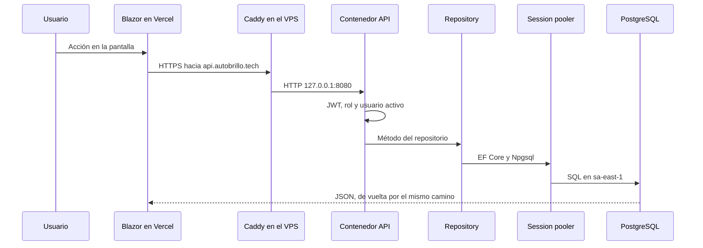

# Guía para la exposición

Pensada para defender AutoBrillo en la UPE con el sistema que está publicado. No hace falta memorizar cada línea. Conviene poder recorrer una solicitud y decir en qué sprint apareció cada módulo.

## La explicación corta

> AutoBrillo está en cuatro capas de código más las pruebas. La web es Blazor WebAssembly en Vercel, con AdminLTE y DataTables. Llama por HTTPS a la API. Caddy, en el VPS de Hostinger, termina el certificado y entrega la solicitud al contenedor. La API valida el JWT y pide los datos a Repository. Repository usa Entity Framework Core y Npgsql contra el session pooler de Supabase, y recién ahí llega a PostgreSQL. La web no conoce la cadena de conexión.

## Qué se entregó en cada sprint

### Sprint 1 — acceso y catálogos administrativos

- Usuarios, roles y login con JWT y BCrypt.
- Estado activo del usuario. Una cuenta inactiva no entra.
- Personas (cliente, funcionario, proveedor) y productos, con tipos de muchos a muchos.
- Precios en guaraníes enteros.
- RLS en esas tablas. La web sigue saliendo solo por la API.

### Sprint 2 — el lavadero y el depósito

- Tipos de vehículo y vehículos del cliente.
- Servicios, adicionales y precio según el tipo de vehículo.
- Insumos que consume un servicio.
- Movimientos de stock y compras a proveedores.
- La cuenta de usuario puede vincularse a una persona.
- Roles de operación: `Supervisor`, `Caja` y `Stock`, además de `Administrador`.

### Sprint 3 — la operación del día y la interfaz

- Lavados, con sector, participantes e historial de estados.
- Ventas, cobros y comisiones. Una sola venta activa por lavado.
- Historial de precios: la fila en uso queda `Vigente` y la anterior se conserva.
- Pantallas con AdminLTE 4.10.2 y listados con DataTables 2.3.4.
- Pruebas en `tests/AutoBrillo.Web.Tests`, ejecutadas por GitHub Actions.

## Dónde está cada cosa

| Capa | Pregunta | Archivo para abrir |
|---|---|---|
| Web | ¿Qué ve la persona? | `src/AutoBrillo.Web/Pages/Login.razor` y `Shared/MainLayout.razor` |
| Web | ¿Cómo se arma un listado? | `src/AutoBrillo.Web/Shared/TablaDatos.razor` |
| API | ¿Quién recibe el login? | `src/AutoBrillo.Api/Controllers/AuthController.cs` |
| API | ¿Cómo arranca el servicio? | `src/AutoBrillo.Api/Program.cs` |
| Repository | ¿Cómo se busca un usuario? | `src/AutoBrillo.Repository/Repositorios/RepositorioUsuarios.cs` |
| Model | ¿Qué datos hay? | `src/AutoBrillo.Model/Entidades/` |
| Datos | ¿En qué orden se creó la base? | `supabase/migrations/` |
| Pruebas | ¿Qué se comprueba solo? | `tests/AutoBrillo.Web.Tests/` |

## Interfaz: AdminLTE y DataTables

Las librerías no se bajan de un CDN en el momento de usar la pantalla. Están copiadas en `src/AutoBrillo.Web/wwwroot/lib` y `index.html` las referencia: AdminLTE 4.10.2, Bootstrap 5.3.8, Bootstrap Icons 1.13.1, DataTables 2.3.4 y jQuery.

`MainLayout` arma la barra y el menú lateral de AdminLTE. El menú cambia con el rol: operación (lavados, ventas y, si es administrador, comisiones), administración completa, o solo inventario y compras para `Stock`.

`TablaDatos` envuelve la tabla HTML. DataTables aporta búsqueda, orden y paginación en español. El componente destruye el plugin antes de que Blazor vuelva a dibujar las filas, para que los botones de editar, activar o anular sigan funcionando. La lógica de JavaScript está en `wwwroot/js/tablas.js`.

## Recorrido completo de una solicitud



El pooler es `aws-1-sa-east-1.pooler.supabase.com` en el puerto 5432. El host directo de la base es solo IPv6 y desde el VPS no se usa.

GitHub Actions no está en ese camino. En cada pull request y en cada push a `main` compila `AutoBrillo.slnx` y corre las pruebas.

## Ejemplo: iniciar sesión

### 1. La pantalla

En `Login.razor` los campos usan `@bind`:

```razor
<label>Usuario <input @bind="credenciales.Nombre" /></label>
<label>Contraseña <input @bind="credenciales.Password" type="password" /></label>
```

Al presionar Ingresar se ejecuta `Ingresar()` en `Login.razor.cs`.

### 2. La web llama a la API

`ServicioAutenticacion.LoginAsync` envía JSON. No abre una conexión a PostgreSQL.

```csharp
var respuesta = await http.PostAsJsonAsync(
    "api/auth/login",
    new { nombre, password });
```

`HttpClient` tiene como base la `ApiUrl` de `wwwroot/appsettings.json`: `https://api.autobrillo.tech/`.

### 3. Caddy y el contenedor

La solicitud llega a `api.autobrillo.tech`. Caddy termina HTTPS y la reenvía a `127.0.0.1:8080`, donde escucha el contenedor `autobrillo-api`.

### 4. La API busca y verifica

`AuthController.Login` pide el usuario a Repository:

```csharp
var usuario = await usuarios.ObtenerPorNombreAsync(request.Nombre.Trim(), cancellationToken);
```

`RepositorioUsuarios` consulta la tabla `usuarios` con Entity Framework Core. Después la API comprueba que el usuario exista, que esté activo y que BCrypt acepte la contraseña. Si algo falla, responde 401 sin decir cuál de las tres cosas falló.

### 5. El token

Si todo coincide, la respuesta es 200:

```csharp
return Ok(new
{
    token = CrearToken(usuario),
    usuario = usuario.Nombre,
    roles = usuario.Roles.Select(x => x.Descripcion),
    esAdministrador = usuario.Roles.Any(rol => rol.Descripcion == "Administrador")
});
```

El JWT dura 8 horas y lleva el identificador, el nombre y un claim por cada rol. La web lo guarda en `localStorage` junto con el nombre y los roles.

### 6. Las pantallas siguientes

`Inicio` y el layout llaman a `ValidarSesionAsync()`. Ese método manda el token a `GET /api/auth/me`. La API, además de validar la firma, vuelve a leer el usuario: si lo desactivaron, la sesión se corta. El menú se arma con `esAdministrador` y la lista de roles.

## Ejemplo: registrar un usuario

`POST /api/auth/register` exige un administrador ya autenticado. El método tiene `[Authorize(Roles = "Administrador")]`. Sin ese token la API responde 401 o 403.

Cuando el administrador llama al endpoint, la API confirma que el nombre no exista, hashea la contraseña y asigna el rol `Administrador`. Para crear una cuenta de caja, stock o supervisor se usa el ABM `POST /api/usuarios`, donde se eligen los roles.

## Despliegue, en una frase por pieza

| Pieza | Dónde | Detalle para decir en voz alta |
|---|---|---|
| Web | Vercel | `vercel.json` de la raíz publica el proyecto Blazor y reescribe las rutas a `index.html`. |
| API | `/opt/autobrillo` | `docker compose -f docker-compose.hostinger.yml`. Imagen `Dockerfile.api`. Contenedor `autobrillo-api`. |
| HTTPS | Caddy | Certificado de `api.autobrillo.tech`. El contenedor no se expone a Internet. |
| Base | Supabase `sa-east-1` | Session pooler, puerto 5432. RLS en las 25 tablas. |
| Esquema | SQL Editor | Los 19 archivos de `supabase/migrations`, en orden, a mano. |
| CI | GitHub Actions | Build y pruebas. No despliega el VPS. |

El procedimiento de actualización del VPS, con los comandos, está en [Despliegue](despliegue.md).

## Guion de la demostración

1. Mostrar el diagrama de [arquitectura](arquitectura.md) y nombrar Vercel, Caddy, el contenedor, el pooler y PostgreSQL.
2. Abrir `wwwroot/index.html` y señalar AdminLTE y DataTables locales.
3. Abrir `TablaDatos.razor` y explicar el listado.
4. Abrir `Usuario.cs` y `RepositorioUsuarios.cs`.
5. Abrir `AuthController.Login` y mostrar el token, los roles y `esAdministrador`.
6. Iniciar sesión en https://autobrillo-lemon.vercel.app y mostrar el menú del rol.
7. Abrir un listado (personas, vehículos o lavados) y usar la búsqueda de DataTables.
8. Mencionar que `POST /api/auth/register` exige administrador.
9. Cerrar con `/health` y `/health/base-datos`.

## Preguntas probables

**¿Por qué hay capas?**

La pantalla no escribe SQL y la base no depende del botón. Cada proyecto se puede explicar solo.

**¿Por qué la web no usa Supabase desde el navegador?**

La cadena de conexión y las reglas quedan en la API. RLS está activo y no hay política para el acceso anónimo.

**¿Por qué el pooler y no el host directo?**

El host directo es solo IPv6. El VPS llega a PostgreSQL por `aws-1-sa-east-1.pooler.supabase.com:5432`.

**¿Por qué Caddy y no otro proxy dentro de Compose?**

Caddy es el proceso que termina HTTPS en el VPS. Compose solo publica la API en `127.0.0.1:8080`. Las etiquetas de otro proxy no forman parte del archivo.

**¿Por qué BCrypt y JWT?**

BCrypt guarda un hash, no la contraseña. El JWT evita enviar la contraseña en cada clic. Dura 8 horas y se invalida si el usuario se desactiva.

**¿Qué hace CORS?**

`WEB_ORIGIN` indica el sitio que puede llamar a la API desde el navegador. En producción es la URL de Vercel.

**¿Dónde están las pruebas?**

En `tests/AutoBrillo.Web.Tests`. GitHub Actions las corre con `.github/workflows/build-test.yml`.

**¿Cómo se actualiza la base?**

Se pega cada archivo nuevo en el SQL Editor, en el orden de [módulos y migraciones](personas-y-productos.md), antes de desplegar la API. Supabase no lleva el historial de esas migraciones.

## Comentarios del código

Hay comentarios `//` sobre un bloque y comentarios `/// <summary>` sobre clases y métodos. Conviene leerlos y después explicar la idea con palabras propias.
