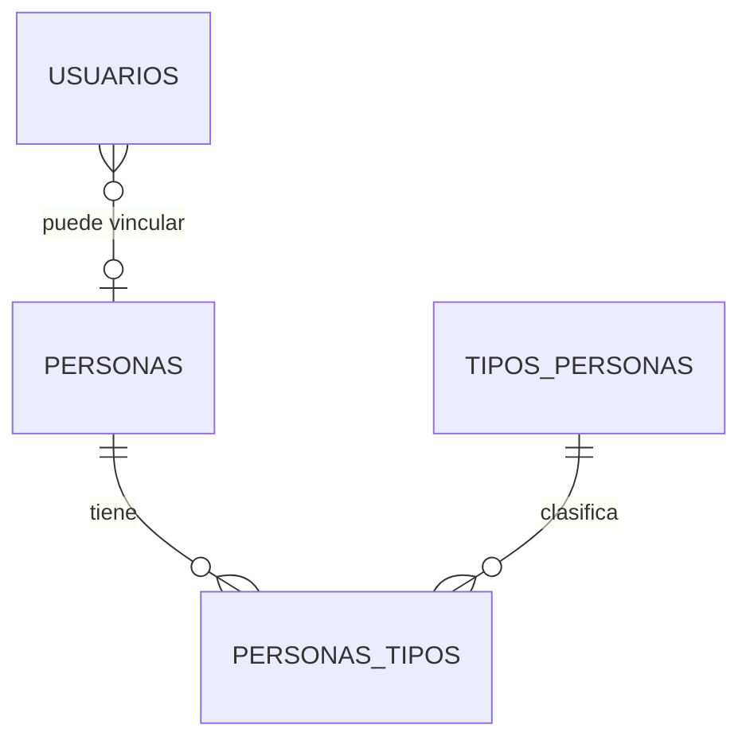
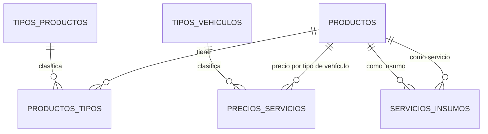

# Módulos, tablas y migraciones

Esta guía cubre los módulos del lavadero, las tablas de PostgreSQL y el orden en que se aplican las migraciones. El archivo conserva el nombre `personas-y-productos.md` porque los primeros módulos fueron personas y productos; el contenido incluye el sistema completo.

La web no consulta Supabase. Toda operación pasa por la API, documentada en [Referencia de la API](api.md).

Los importes están en guaraníes enteros (`numeric(18,0)` después de la migración que quitó los decimales).

## Tablas de `public`

Las migraciones crean 25 tablas. Cada una tiene `row level security` habilitado y ninguna define una política para el rol anónimo.

| Tabla | Módulo |
|---|---|
| `usuarios` | Acceso |
| `roles` | Acceso |
| `usuarios_roles` | Acceso. N:M usuario–rol. |
| `tipos_personas` | Personas |
| `personas` | Personas |
| `personas_tipos` | Personas. N:M persona–tipo. |
| `tipos_productos` | Catálogo |
| `productos` | Catálogo |
| `productos_tipos` | Catálogo. N:M producto–tipo. |
| `tipos_vehiculos` | Vehículos |
| `vehiculos` | Vehículos |
| `precios_servicios` | Servicios. Historial; la fila en uso tiene `Vigente`. |
| `servicios_insumos` | Servicios. Insumos que consume un servicio. |
| `movimientos_stock` | Inventario |
| `compras` | Compras |
| `compras_detalle` | Compras |
| `lavados` | Operación |
| `lavados_servicios` | Operación |
| `lavados_participantes` | Operación |
| `lavados_historial_estados` | Operación |
| `ventas` | Operación |
| `ventas_detalle` | Operación |
| `cobros` | Operación |
| `configuracion_comision` | Comisiones |
| `comisiones` | Comisiones |

## Personas

Un cliente es una persona cuyo tipo incluye `Cliente`. La misma persona puede ser, además, proveedor o funcionario.

### `personas`

| Campo | Tipo | Regla |
|---|---|---|
| `Id_Personas` | entero | PK, identidad. |
| `Nombre` | varchar(150) | Obligatorio. |
| `Documento` | varchar(50) | Obligatorio y único. Cédula o RUC. |
| `Telefono` | varchar(30) | Opcional. |
| `Activo` | boolean | Inicia en `true`. Desactivar no borra la fila. |

### `tipos_personas`

| Campo | Tipo | Regla |
|---|---|---|
| `Id_Tipos_Personas` | entero | PK. |
| `Descripcion` | varchar(100) | Obligatoria y única. |

Datos iniciales: `Cliente`, `Funcionario`, `Proveedor`.

### `personas_tipos`

Clave compuesta `Id_Personas` + `Id_Tipos_Personas`. Borrar la persona borra sus vínculos. No se puede borrar un tipo que todavía esté asignado.

Nombre y documento son obligatorios, el documento no se repite y hace falta al menos un tipo.

En la pantalla, los tipos de persona se eligen con una lista siempre visible de casillas (`form-check`): la casilla a la izquierda y la etiqueta a la derecha. No es un desplegable.

## Usuarios y roles

`usuarios` guarda `Nombre` único, `Password` (solo hash BCrypt), `Activo` y, en forma opcional, `Id_Personas`. Un usuario inactivo no inicia sesión. La relación con `roles` es N:M mediante `usuarios_roles`.

Roles iniciales: `Administrador`, `Funcionarios`, `Caja`, `Stock` y `Supervisor`. La API autoriza con `Administrador`, `Supervisor`, `Caja` y `Stock`.

`POST /api/auth/register` exige un administrador ya autenticado y asigna el rol `Administrador` al usuario nuevo. Otros roles se cargan por el ABM `/api/usuarios`.

## Productos

### `productos`

| Campo | Tipo | Regla |
|---|---|---|
| `Id_Productos` | entero | PK. |
| `Descripcion` | varchar(150) | Obligatoria y única. |
| `PrecioDeCosto` | numeric(18,0) | No negativo. Guaraníes enteros. |
| `PrecioDeVenta` | numeric(18,0) | No negativo. |
| `Activo` | boolean | Inicia en `true`. |
| `StockActual` | numeric(18,0) | Inicia en 0. No negativo. |

### `tipos_productos`

`Descripcion` única. Datos iniciales: `Servicio`, `Producto`, `Insumo` y, desde el sprint 2, `Adicional`.

### `productos_tipos`

Clave compuesta. No se elimina un tipo que esté en uso. Al eliminar el producto se eliminan sus vínculos.

La descripción es única, hace falta al menos un tipo y el stock de una edición no se cambia por el `PUT` de productos: entra por compras o por movimientos.

En la pantalla, Servicio, Producto, Insumo y Adicional se marcan con la misma lista de casillas. Los roles de un usuario siguen en tarjetas: no son un selector de tipos.

Las tablas de personas, productos y el resto de los listados muestran la columna Acciones con botones compactos (`btn-sm`) agrupados en una sola línea, con ícono y texto accesible.

## Vehículos

`tipos_vehiculos` tiene descripción única y estado activo. Datos iniciales: `Moto`, `Auto`, `Camioneta`, `Furgón / Utilitario`.

`vehiculos` apunta a una persona y a un tipo. Guarda patente, marca, modelo, color y `Activo`. La patente es única una vez normalizada (mayúsculas, sin espacios).

## Servicios y precios

Un servicio o un adicional es un producto con ese tipo. `precios_servicios` guarda el precio de ese producto para un tipo de vehículo, la fecha, el usuario y la columna `Vigente`.

Al cargar un precio distinto, la fila anterior pasa a `Vigente = false` y se inserta otra. El índice único `ux_precios_servicios_vigente` permite una sola fila vigente por producto y tipo de vehículo. `GET /api/precios-servicios` devuelve solo las vigentes. Borrar un precio desde la API también lo marca como no vigente: el historial permanece.

`servicios_insumos` dice qué insumos, y en qué cantidad, consume un servicio. El consumo descuenta stock y deja un movimiento.

## Inventario y compras

`movimientos_stock` registra fecha, tipo, origen, cantidad, stock resultante, una referencia opcional, una observación y el usuario.

`compras` es la compra a un proveedor (`Id_Personas`), con comprobante, total, estado y datos de anulación. `compras_detalle` son las líneas: producto, cantidad, precio unitario y subtotal. Registrar suma stock. Anular queda reservado al administrador.

## Lavados, ventas, cobros y comisiones

`lavados` une un vehículo, un sector y una fecha. Tiene estado, usuario, motivo de anulación y fecha de cierre. `lavados_servicios` guarda el servicio o el adicional y el precio aplicado. `lavados_participantes` son los funcionarios. `lavados_historial_estados` anota cada cambio de estado.

`ventas` puede apuntar a un lavado. Tiene condición, total, estado y anulación. El índice `ux_ventas_lavado_activa` deja una sola venta no anulada por lavado. `ventas_detalle` son las líneas. `cobros` registra medio de pago, importe y usuario.

`configuracion_comision` guarda el porcentaje global. `comisiones` reparte ese porcentaje entre los participantes de la venta. Cambiar el porcentaje afecta a las ventas nuevas.

## Migraciones

Hay 19 archivos en `supabase/migrations`. Se ejecutan en el SQL Editor de Supabase, en este orden, antes de desplegar la API que los necesita. No se aplican con la CLI. El historial de migraciones de Supabase queda vacío y la integración de GitHub está desconectada a propósito.

1. `20260906010000_crear_usuarios.sql` — tabla `usuarios` y RLS.
2. `20260912230000_agregar_roles_y_usuario_rol.sql` — `roles`, datos iniciales y un rol temporal en el usuario.
3. `20260912231000_convertir_usuario_roles_a_muchos_a_muchos.sql` — `usuarios_roles` y se retira el rol único.
4. `20260912232000_corregir_secuencia_usuarios.sql` — alinea la secuencia de `Id_Usuarios`.
5. `20261025090000_agregar_estado_activo_usuarios.sql` — columna `Activo`.
6. `20261025100000_crear_personas_y_tipos.sql` — personas, tipos y el puente.
7. `20261025110000_crear_productos_y_tipos.sql` — productos, tipos y el puente.
8. `20261026100000_productos_sin_decimales.sql` — precios y stock a `numeric(18,0)`.
9. `20261027010000_habilitar_rls_tablas_administrativas.sql` — RLS de personas y productos.
10. `20261111010000_crear_tipos_vehiculos_y_precios.sql` — tipos de vehículo y precios.
11. `20261111020000_crear_vehiculos.sql` — vehículos.
12. `20261111030000_crear_movimientos_stock.sql` — movimientos.
13. `20261111040000_crear_compras.sql` — compras y detalle.
14. `20261111050000_crear_adicionales_e_insumos_servicio.sql` — tipo `Adicional` e insumos del servicio.
15. `20261111060000_vincular_usuario_persona.sql` — `usuarios.Id_Personas`.
16. `20261111070000_habilitar_rls_sprint2.sql` — RLS de las tablas del sprint 2.
17. `20261112010000_sprint3_lavados_ventas_comisiones.sql` — lavados, ventas, cobros, comisiones y su RLS.
18. `20261125180000_historial_precios_vigentes.sql` — columna `Vigente` y el índice de una fila vigente.
19. `20261125180100_venta_activa_por_lavado_y_patentes.sql` — una venta activa por lavado y patentes comparables.

`supabase/scripts/opcional_reconciliar_stock.sql` no es una migración. Es un script aparte para reconciliar stock si hiciera falta; no forma parte del orden anterior.

Las dos últimas hay que aplicarlas antes de una API que lea `Vigente` o el índice de venta activa. Son idempotentes. Si el índice de ventas no se puede crear, hay dos ventas no anuladas para el mismo lavado: se anula la duplicada y se vuelve a ejecutar el archivo.
